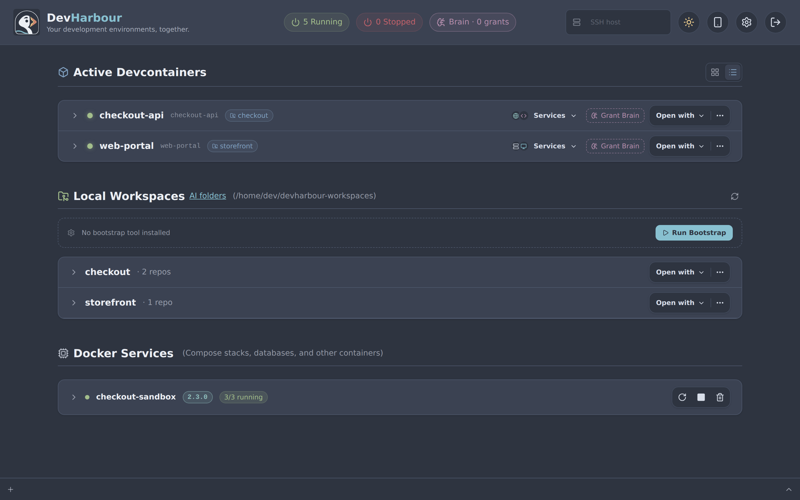
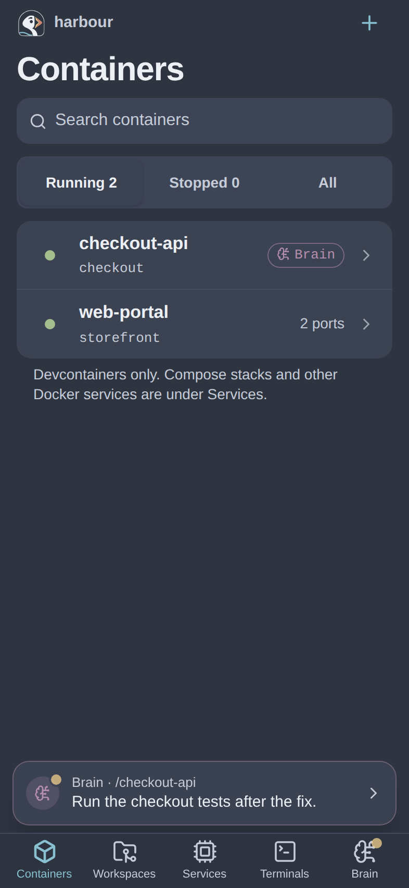
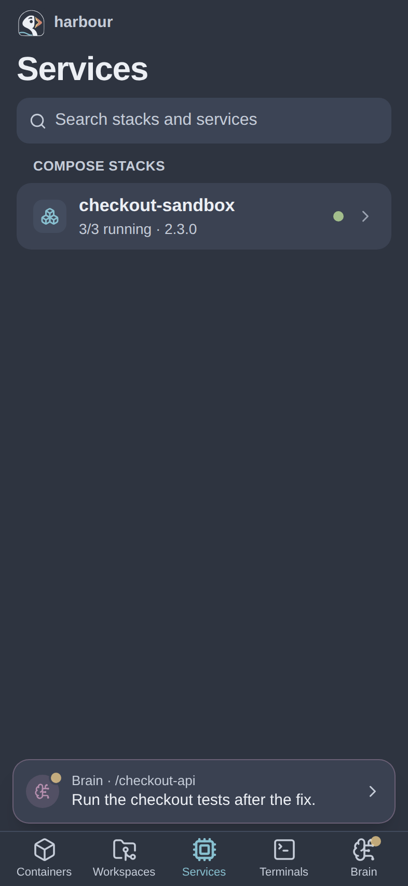
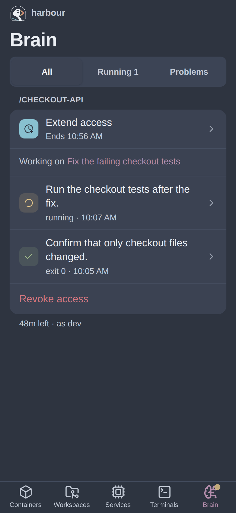
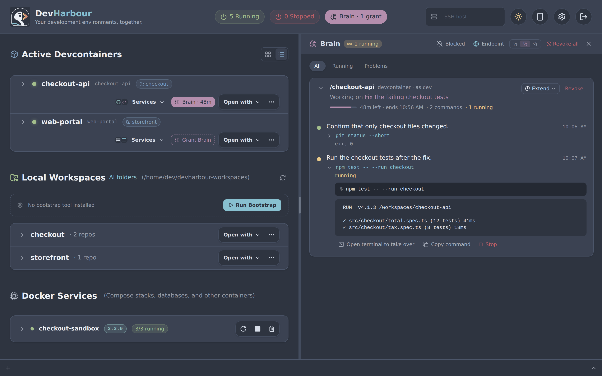

# DevHarbour


DevHarbour is a self-hosted dashboard for development environments. Build and run
Dev Containers and Docker Compose sandboxes, then open terminals, editors, AI
coding tools, and project services from your browser.



Phones get a dedicated mobile interface for containers, services, terminals and
agent activity.

<p align="center">
  
  
  
</p>

## Quickstart

**You need:** A Linux host with running Docker that your user can access, Bash,
`curl`, and Python 3.9+ with `venv` and `pip`. The quickstart also needs one
SSH agent that DevHarbour can verify on the Docker host. You do not need Node.js.

1. On the Docker host, run the [installer](scripts/install-devharbour.sh) as your
   normal user, without `sudo`. The command runs the installer from `main`.
   Only run the installer from a source you trust.

   ```bash
   curl -fsSL https://raw.githubusercontent.com/axelthas/devharbour/main/scripts/install-devharbour.sh | bash
   ```

2. Start DevHarbour and set a login password of at least 12 characters when asked.

   ```bash
   devharbour
   ```

   If the command is not on your `PATH`, use `~/.local/bin/devharbour` or follow
   the installer's `PATH` instructions.

3. Open [http://127.0.0.1:3000](http://127.0.0.1:3000) on the host and sign in.

The installer installs the CLI without cloning the repository. The first run
uses `ghcr.io/axelthas/devharbour:latest` and binds to localhost. DevHarbour pulls
the image if it is not already present. If DevHarbour cannot identify your host account or
SSH agent, run `devharbour setup` to choose them explicitly.

**Use `devharbour setup`** for a custom workspace, private Tailscale HTTPS, or a
local image build. Choose **Save only**, then run `devharbour apply` to review and
start the deployment. Merging to `main` does not publish a Docker image. To use
changes that are not in a release yet, select a local build from `main` in setup
(requires Git and Docker Buildx).

## Open your first project

1. Put a Git repository with a `devcontainer.json` under your workspace root in
   `<workspace-root>/<project>/<repository>` order. The quickstart workspace
   root is `~/devharbour-workspaces`.
2. In **Local Workspaces**, find the repository and select **Build & Start**.
3. Use **Open with** to open a terminal or editor. Use **Services** to open the
   ports the container publishes.

## Manage DevHarbour

Open **Settings** in the desktop header or the mobile **Host** sheet to edit the
same configuration as the CLI. **Save only** does not change the running
instance. Use **Save & recreate** to review and apply new edits, or **Review and
recreate** to apply changes you already saved. Recreation retains named volumes,
but ends DevHarbour login sessions, agent grants, and active terminals. Direct
launcher deployments do not have managed Settings by default. Older managed
instances may need one reviewed recreation from the CLI to enable Settings.

| Command              | What it does                                            |
| -------------------- | ------------------------------------------------------- |
| `devharbour status`  | Show the managed instance status.                       |
| `devharbour logs`    | Show its logs.                                          |
| `devharbour open`    | Open the last successfully applied URL.                 |
| `devharbour apply`   | Review and apply saved configuration.                   |
| `devharbour restart` | Restart the current container without applying changes. |
| `devharbour stop`    | Stop the managed instance.                              |

Run the installer again to update the CLI. It preserves your configuration and
data. It does not update the running Docker image. See the
[CLI reference](scripts/README.md#installed-devharbour-cli) for image choices,
unattended setup, and upgrades from Devcontainer Dashboard.

## Optional: connect an external agent over MCP

Enable the DevHarbour MCP server in Settings or the setup wizard. It is off by
default. In your agent's MCP client, enter the `/mcp` URL shown in the **Brain**
panel and set `Authorization: Bearer <token>`. If the agent runs off-host, it
needs a reachable HTTPS endpoint.

Select **Grant Brain** on each running container the agent may use. Agents can
ask for more time, but only the operator can extend or revoke access.



DevHarbour has Docker access, and anyone who can sign in has operator access.
Keep the dashboard on localhost or a trusted private network. Optional Tailscale
Funnel exposes the token-protected MCP endpoint, not the dashboard. See the
[MCP access guide](specification/feature_brain_access/feature_specification_brain_access.md)
for connection details and grant behavior.

## Develop DevHarbour

For local development, use Node.js 22, Docker access, and a C++ build toolchain
with Python 3 for `node-pty`. Run `npm ci` from a checkout. Then set
`DASHBOARD_PASSWORD` and `WORKSPACE_ROOT` to a login password and an existing
workspace directory, respectively. Start Vite with `npm run dev -- --host 127.0.0.1`.
For production checks, see [AGENTS.md](AGENTS.md#build--test). After a build,
run `node scripts/capture-readme-screenshots.mjs` to refresh the README
screenshots from demo data.

## More documentation

- [Deployment and CLI reference](scripts/README.md): configuration, SSH agent
  forwarding, Tailscale, and the direct launcher.
- [Settings guide](specification/feature_settings/feature_specification_settings.md):
  saved versus applied configuration and recovery after a failed recreation.
- [Compose sandbox guide](specification/feature_compose_sandbox/feature_specification_compose_sandbox.md):
  run sandboxes and connect devcontainers to their networks.
- [Developer guide](AGENTS.md) and [architecture](ARCHITECTURE.md): local
  development, project conventions, and checks.
