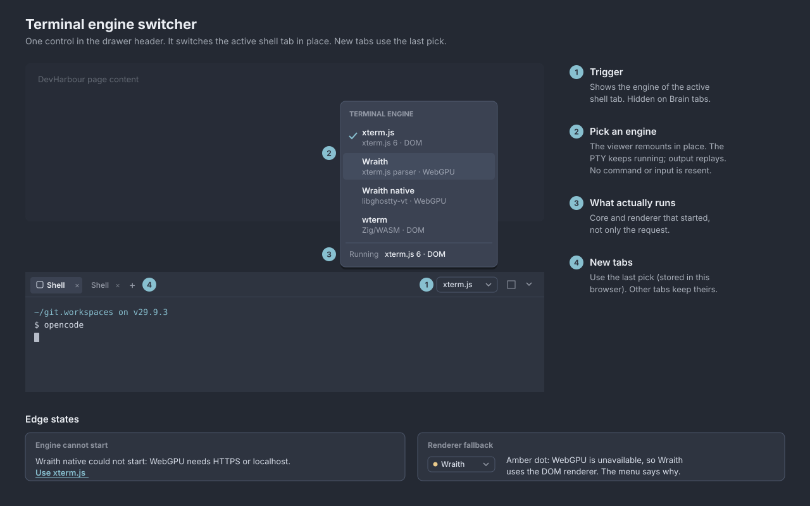

# Terminal engine switcher

Part of [#42](https://github.com/axelthas/devcontainer-dashboard/issues/42). Replaces the
selector design of draft PR #44. PR #44 stays a technical reference for the engine adapters.

## Goal

The operator switches the terminal engine of an open shell tab on the fly, with one
control. The engines are xterm.js, Wraith (xterm API), Wraith native (libghostty-vt), and
wterm. xterm.js stays the default.

## Behavior

1. The terminal drawer header shows one engine switcher on the right, next to
   **Maximize**. The switcher shows the engine of the active shell tab.
2. The switcher is visible only when the drawer is open and a shell tab is active. Brain
   tabs keep xterm.js and show no switcher.
3. The switcher opens a menu above the drawer. The menu lists the four engines. Each item
   shows the engine name and its core and renderer on one line.
4. When the operator selects an engine, the active tab replaces its browser viewer in
   place. The PTY keeps running. The new viewer attaches by session ID and replays retained
   output. The dashboard does not resend the start command or user input.
5. After a switch, keyboard focus goes to the new viewer.
6. The selected engine also applies to new shell tabs. The browser stores this choice in
   `localStorage` key `devcontainer-dashboard-terminal-engine`. Other open tabs keep their
   engine.
7. The menu footer shows the core and renderer that actually started.
8. When an engine runs a fallback renderer (for example Wraith without WebGPU), the switcher
   shows an amber dot. The menu footer gives the reason.
9. When an engine cannot start, the pane shows the reason and a **Use xterm.js** action. The
   PTY keeps running.

## Removed from the PR #44 design

- Engine items in **Open with** menus.
- The separate **New** and **This terminal** selectors.
- Engine badges on every tab.
- The engine selector in the OpenCode TUI window.

## Out of scope

- Brain terminal tabs. They use read-only input and LF conversion that the adapters do not
  expose yet.
- Bootstrap and devcontainer build log viewers.
- The OpenCode compatibility matrix, performance report, and devcontainer **Open with**
  work in #42.

## Lifecycle rules

- Browser disconnect, drawer collapse, tab close, engine switch, and process exit are
  different events. Only tab close and process exit end a shell. An engine switch only
  disposes the viewer.
- Engine factories mount a viewer only. They do not open sockets, create PTYs, or run
  commands. `TerminalTab` keeps the JSON WebSocket transport, attach-only reconnects, input
  gating, and geometry guards.
- Wraith's own WebSocket transport and wterm WebMCP are not used.
